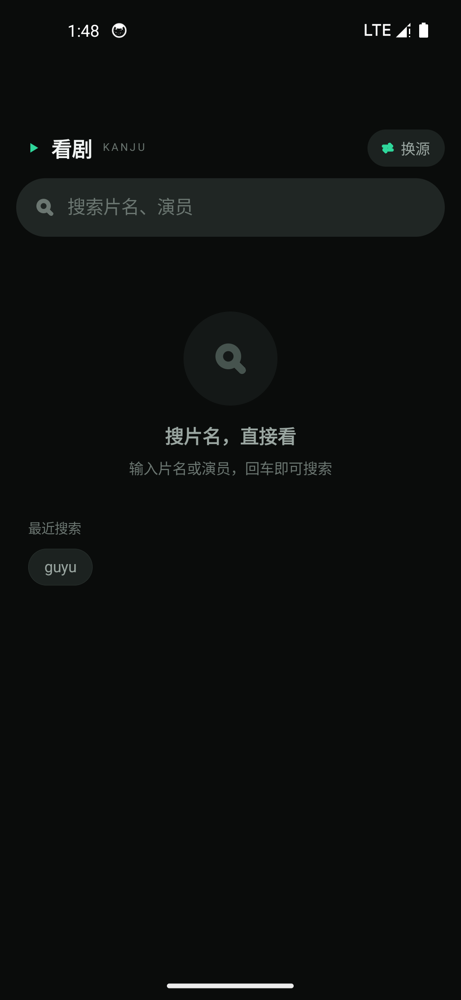

# KanjuNative · 看剧（原生播放器）

用 **Android 原生控件** 直连 `kanju.ai` 的公开接口实现的最小可用播放器。
没有 WebView、没有第三方 SDK、没有广告：UI 全部是 `ListView` / `SeekBar` / `MediaPlayer` / `TextureView` 这类系统控件，
图标用 `Canvas` 手绘，所以 release 包只有 **77 KB**。

交互走 B 站 / 爱奇艺 / 腾讯视频的路子：**搜索结果先进竖屏详情页选集，点哪一集才进横屏播放**。

> 上一个 WebView 壳版本保留在 `../KanjuLite`（tag `v1-webview`）。

---

## 一、功能

**首页（对齐 Chrome 移动端新标签页）**

- 顶部一条胶囊搜索框：深色填充、无描边、左内嵌放大镜，右侧仅在输入时出现「清除 / 前往」
- 只搜片名/演员，回车或点前往即出结果，结果用 `ListView` 渲染（海报 + 年份地区 + 演员 + 备注）
- 换源偏好：自动优选 / 官方线路 / 4K高清 / 海外线路 / 资源站
- 最近搜索：搜过的关键词以胶囊列出，一点即搜（本地只存 8 条）

**详情页（竖屏选集，v1.2 新增）**

- 顶部海报做背景并向下渐隐，压着封面 + 标题 + 更新状态 + 年份/地区/类型 + 主演
- 主按钮：没有记录时是「播放 第1集」，看过就是「继续观看 第N集 · 12:34」，点了从断点续播
- 选集：5 列网格，最近看的那一集用描边高亮；点任意一集进播放页播那一集
- 简介默认 4 行 + 展开/收起
- 右侧「换源」改线路优先级（真正几十条线路在播放页里逐条换）
- 单集电影自动隐藏选集区；没有播放源时按钮变灰显示「暂无播放源」

**播放页（横屏沉浸）**

| 能力 | 说明 |
| --- | --- |
| 播放 / 暂停 | 中央按钮，点画面可显隐控制栏 |
| 进度调节 | `SeekBar` 拖动，暂停态也能拖；时间精确到秒 |
| 倍速 | 0.5x / 0.75x / 1x / 1.25x / 1.5x / 2x / 3x，选中即生效并记住 |
| 锁屏 | 隐藏所有控制，只留「已锁定 · 点击解锁」，防误触 |
| 选集 | 6 列网格，当前集高亮；支持上一集 / 下一集按钮（详情页也能选） |
| 换源 | 列出已排序线路（mp4 直链优先，其次 HLS），点一条即切 |
| 跳过片头 | 取站点社区统计的中位数（本剧 90s），一键跳到片头结束 |
| 跳过片尾 | 剩余时长进入片尾区间时出现，点一下直接进下一集 |
| 断点续播 | 按集 token 记录播放位置（哈希做 key，避免同剧共用前缀） |
| 自动处理 | 播完自动下一集、自动跳过片头（可关）；线路失败自动换下一条（16s 看门狗） |
| 片头片尾校正 | 「更多」里可把当前进度设为片头结束 / 片尾起点，按剧记忆 |

---

## 二、截图

| 首页 | 搜索结果 |
| --- | --- |
|  |  |

| 播放控制 | 选集 |
| --- | --- |
|  |  |

| 倍速 | 锁屏 |
| --- | --- |
|  |  |

| 竖屏详情页（选集） | 从详情页续播 |
| --- | --- |
|  |  |

---

## 三、构建

```bash
# JDK 17 + Android SDK 35
./gradlew assembleRelease     # 产出 app/build/outputs/apk/release/app-release.apk
./gradlew assembleDebug
```

release 用 debug 签名（`signingConfig signingConfigs.debug`），可直接侧载，但不能上架。

产物已复制到 `dist/`：

- `KanjuNative-1.2.0-release.apk`（77 KB）
- `KanjuNative-1.2.0-debug.apk`（93 KB，含调试信息）

---

## 四、实现要点

### 1. 接口签名

站点 `/v1/*` 需要四个头：`x-ai-movie-timestamp`、`x-ai-movie-nonce`、`x-ai-movie-signature`、
`x-ai-movie-client-name`（另外还有 client/build/protocol-version 三个固定值）。

签名算法（在站点打包产物 `movie-card-runtime-*.js` 里找到）：

```
signature = hex( HMAC_SHA256( key, METHOD + "\n" + pathAndQuery + "\n" + timestamp + "\n" + nonce ) )
```

`Api.java` 里用 `Mac.getInstance("HmacSHA256")` 原样复现，纯 Java，无依赖。

### 2. 链路

```
POST /v1/threads                                    → thread_id
GET  /v1/browse/catalog?q=&page=&limit=20           → cards[]（搜索）
GET  /v1/catalog/{variantId}/detail                 → 简介 + playback_skip_settings_preset
GET  /v1/catalog/{variantId}/episodes?limit=48      → episodes[].token
GET  /v1/playback/resolve/{token}?view=compact      → line_options[]（几十条线路）
POST /v1/playback/resolve-line（body={ticket}）      → 真实 mp4 / m3u8 地址
```

- `kanju.ai` 本身可以直接当 API 域名，不必跟着播放域名漂移
- 线路里有伪线路（`.jpg/.png`），`Api.order()` 会剔除，并按 mp4 → m3u8 排序
- 片头片尾来自 detail 的 `playback_skip_settings_preset`（`source=community_median`）

### 3. 为什么是 TextureView

`SurfaceView` 在模拟器上不出画，`adb screencap` 也抓不到画面；换成
`FrameLayout + TextureView + MediaPlayer` 后正常。`PlayerView` 自己按 `videoW/videoH` 做居中 letterbox。

### 4. 底部面板不用 Dialog

横屏下 `Dialog` 的独立窗口首帧会把内容量成 0 宽（表现为空白面板）。`Sheet` 改成直接叠加在
`android.R.id.content` 上的浮层，宽度永远等于真实屏幕宽度。

### 5. 详情页与播放页的分工

`DetailActivity` 只负责「看 / 选集」，不放视频；`PlayerActivity` 只负责播放，通过
`EXTRA_EPISODE` 接收要播第几集（缺省才回退到「上次那一集」）。这样返回键语义很干净：
播放页按返回就退回详情页，转屏交给底栏的全屏按钮，不再出现「按返回先竖过来」的割裂感。

详情页顶部的沉浸式背景有个坑：API 30+ 调用 `setDecorFitsSystemWindows(false)` 之后，
状态栏图标会被系统改回深色（深色海报上直接看不见）。这里只用老的
`SYSTEM_UI_FLAG_LAYOUT_FULLSCREEN` 且**不清除** `LIGHT_STATUS_BAR`，图标才能保持白色。

### 6. 图标

`Ui.Icon` 是一个 24x24 网格的 `Canvas` 画笔，`onDraw` 里先扣掉 padding 再按 `min(w,h)/24` 缩放——
不扣 padding 的话 `iconButton(icon=34, pad=20)` 的播放箭头会被放大到 74dp（之前「图标过大」就是这个原因）。

---

## 五、已知限制

- 只做了手机竖屏（首页 / 详情）+ 横屏播放，没有平板布局
- 线路可播性依赖站点，资源站那几十条经常返回 `invalid_public_playback_id`，靠自动换源兜底
- 字幕/音轨切换、投屏、下载未实现
- release 未混淆（`minifyEnabled false`），方便对照日志

---

## 六、目录

```
app/src/main/java/com/kanju/player/
  Api.java          签名 + 全部 HTTP 接口 + 线路排序
  Models.java       Movie / Detail / Episode / Line / Playback
  HomeActivity.java 首页：Chrome 式搜索框 + ListView + 最近搜索 + 换源
  DetailActivity.java 竖屏详情：海报头图 + 继续观看 + 选集网格 + 简介 + 换源
  PlayerActivity.java 播放页：控制栏 / 选集 / 换源 / 倍速 / 锁屏 / 跳片头片尾
  PlayerView.java   TextureView + MediaPlayer 封装
  Sheet.java        底部面板（叠在内容层上的浮层）
  Ui.java           色板、圆角、20 个手绘图标、开关
  Store.java        SharedPreferences：偏好 / 倍速 / 断点 / 最近一集 / 片头片尾
  ImgLoader.java    海报：内存 LruCache + 磁盘缓存 + 采样
  PosterView.java   圆角海报
```
